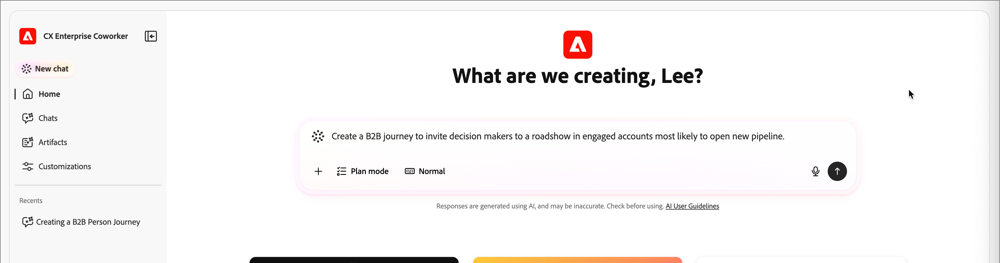

# B2B的历程技能

在[!DNL CX Enterprise Coworker]聊天中，历程技能可帮助您通过自然语言设计、执行、优化和监控[!DNL Adobe Journey Optimizer B2B Edition]历程。 运用这些技能，通过将自动化、数据驱动型推荐和实时可观察性相结合，可减少构建和管理帐户和人员历程所需的时间和复杂性。

[!DNL CX Coworker]提供了一组AI技能，其中包括B2B历程生命周期的子集。 这些当前可用的技能包括：

* **[历程创建技能](#journey-creation-skills)** — 根据自然语言提示创建、更新和优化历程
* **[历程可观察性技能](#journey-observability-skills)** — 询问有关帐户和人员如何在活动历程中移动的问题

单击应用程序顶部的&#x200B;_询问[!DNL Coworker]_ （![询问[!DNL Coworker]](../assets/do-not-localize/icon-ask-coworker.svg) ）图标以打开[!DNL Coworker]界面。

## 历程创建技能 {#journey-creation-skills}

历程创建技能将您的营销目标、参与策略和KPI转换为完整的B2B客户历程。 它们解决了当前B2B营销人员面临的三大挑战：

* 处理日益复杂的客户历程（受众、内容和消息传送以及全渠道的复杂性）
* 在预算紧张的情况下提高效率
* 了解应如何构建最佳客户历程

作为营销人员，您可以使用这些技能执行以下操作：

* **创建** — 将营销目标、产品、参与策略和KPI转化为具有自动化和条件的个性化客户历程
* **推荐** — 利用过去的营销参与和其他历史数据优化历程创建
* **优化** — 根据预测或实际性能分析、调整和优化活动历程
* **管理** — 优先处理、管理和编排重叠的历程和消息投放

### 基本用法

要使用历程创建技能，请使用自然语言在[!DNL Coworker]提示窗口中键入您要创建的内容：

“创建一个B2B之旅，邀请最有可能开辟新管道的参与客户参加路演。”

在[!DNL CX Coworker]{width="800" zoomable="yes"}中为B2B提示创建历程的技能

您提供的细节越多，回复就越好。 如果您有描述该事件或您的产品等的现有营销材料，请将其粘贴到提示中，以便[!DNL Coworker]更好地了解目标。

“充当B2B历程战略家，创建一个多阶段客户帐户历程，在`<Solution Name>`的早期探索阶段培养和吸引决策者和营销人员。 目标是将匿名访客转化为已知联系人，深化对`<domain>`.com上相关内容的参与，并为`<Product Name>`销售推广活动吸引合格的潜在客户。 利用现有受众区段和内容，使用电子邮件和付费媒体等渠道。 构建涵盖意识、考虑和评估阶段（4-6周）的历程，并针对每个阶段提供明确的触发器、操作和目标。 包括转化率、参与分数和演示请求等KPI，并将输出作为结构化历程流返回。”

此详细提示提供：

* **清除意图**：您希望AI做什么？ 明确任务或结果。
* **Context-Rich**：提供相关的背景或约束。 如果可能，请包含示例或引用。
* **结构化格式**：使用项目符号、编号步骤或模板。
* **角色分配**：指定AI的角色 — “充当数据分析师……”

从简单的提示开始，然后根据结果优化提示。 使用跟进提示进行迭代。

### 端到端的B2B历程创建

历程创建技能可以通过对话体验而不是传统用户界面从自然语言文本提示和元数据生成端到端历程流（帐户或人员历程）。

端到端历程提示示例：

* 创建一个跨渠道历程，以培养过去30天内未使用我的内容的客户。
* 创建一个历程，通过为最重要的购买群组角色提供个性化内容，向意图鲜明的客户交叉销售解决方案，而无需开辟渠道。
* 创建B2B历程以邀请最有可能打开新管道的参与客户参加路演。
* 为意图用于我的解决方案的空白帐户创建一个历程，重点关注参与网站内容的人员。

### 多阶段历程

您可以充当B2B历程设计者，以创建多阶段客户帐户历程，在探索阶段的早期通知决策者和营销人员。 目标是将匿名访客转化为已知联系人，深化对相关内容的参与，并争取符合条件的销售线索。

* 使用渠道（如`Email`、`Paid media`、`Personalized web experiences`）来利用现有的受众区段和内容。
* 在4-6周内跨`awareness`、`consideration`和`evaluation`阶段构建历程，其中每个阶段具有明确的触发器、操作和目标。
* 包括KPI（如`conversion rates`、`engagement scores`和`demo requests`），并将输出作为结构化历程流返回。

## 历程可观察性技能 {#journey-observability-skills}

历程可观察性技能让您能够询问关于帐户和人员如何在B2B历程中移动的自然语言问题，而无需挖掘历程地图、日志或仪表板。 它们涵盖两个主要领域：旅程进展和数据同步可观察性。

![在[!DNL CX Coworker]](./assets/journey-observability-prompt-response.png){width="800" zoomable="yes"}中历程可观察性提示和响应

### 帐户级别历程insight

通过提出以下问题，跟踪特定帐户如何在历程中流动：

* “给我有关Bodea Cloud帐户的基本信息。”
* “告诉我Northstar Services客户如何经历了ABM培养战略的历程。”
* “Contoso LLC客户何时开始此历程？”

### 分割路径推理和计数

了解为什么使用分支以及遵循每个路径的人员或帐户数量：

* “为什么帐户QiDemoAccount24转到位于拆分节点c764a9的美国加利福尼亚小型技术路径？”
* “告诉我拆分节点node-459c7c中每条路径的人员数。”
* “让我看看圣何塞帐户8的路径上的人。”

历程可观察性技能可分析拆分逻辑、帐户属性和活动，以解释路由选择决策和按路径返回计数或人员列表。

### 人员级别的历程结果

在一个帐户内或整个历程中分析单个结果 — 对于购买群体分析和跟踪决策者与影响者的行为特别有用：

* “让我计算一下Bodea下一次Web参与之旅的每个拆分路径中的人员数量。”
* “列出隐藏跳过路径中的人员。”
* “让我看看此帐户在圣地亚哥位置路径的人员。”

### 历程生命周期和时间

检索历程或特定帐户的关键时间戳：

* “这段旅程什么时候上线的？”
* “第一个帐户何时进入此历程？”
* “QiDemoAccount50帐户何时开始此历程？”

### 外部受众和激活可见性

对于推送到外部渠道（如LinkedIn）的历程，您可以检查激活状态：

* “bsmith@acme.com是否位于外部受众中？”
* “列出通过ObservabilityExtAudience01激活到LinkedIn的所有人员。”

### 数据同步和管道可观察性

历程可观察性技能还可以提供数据同步运行状况信息，帮助排除客户或商机为什么没有包含在历程中的问题：

* 外部受众导出作业指标和状态
* 批量分段计划和完成时间
* 购买团体维护计划
* 作业管理器统计信息（已完成/失败）