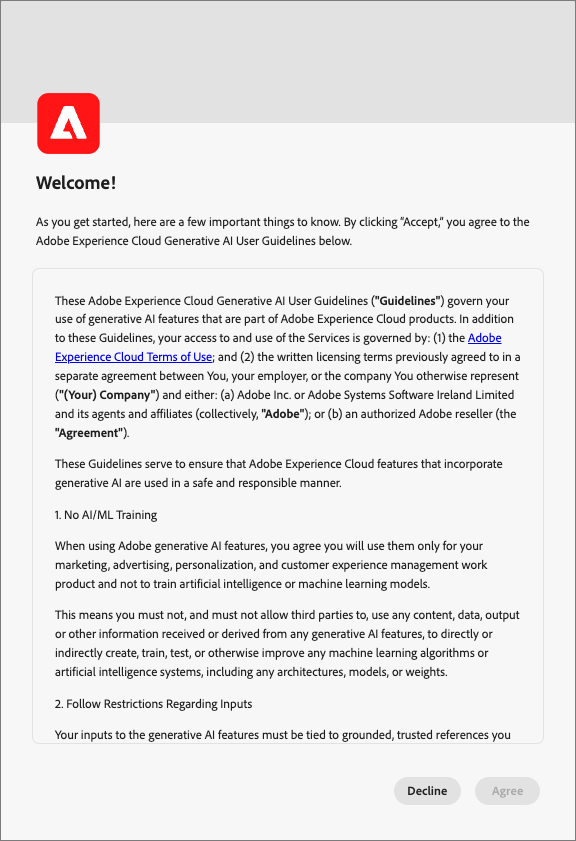
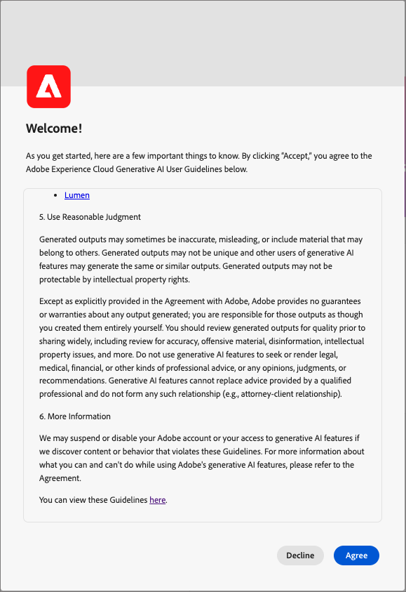

# Journey Optimizer B2B Edition中的AI功能

使用[!DNL Adobe Journey Optimizer B2B Edition]中的AI功能生成内容、探索产品知识并获得运营见解。

>[!IMPORTANT]
>
>在[!DNL Journey Optimizer B2B Edition]中使用AI功能之前，需要与[用户准则](https://www.adobe.com/cn/legal/licenses-terms/adobe-gen-ai-user-guidelines.html){target="_blank"}达成协议。 此协议还包含公共测试版协议，以便您可以在推出时使用其他启用了人工智能的功能。

+++查看用户协议界面

+++

## 使用[!DNL Coworker]应用 {#coworker-app}

将[!DNL CX Enterprise Coworker]应用程序界面用于除生成内容之外的所有聊天工作流。 提出产品问题，探索运营见解，并使用B2B帐户和人员的[历程技能](../agents/journey-agent.md)和[受众技能](../agents/audience-agent-b2b.md)。 在[!DNL Journey Optimizer B2B Edition]内，内容生成保持可用。

有关打开应用程序、开始对话和使用聊天功能的说明，请参阅[CX Coworker界面指南](https://experienceleague.adobe.com/en/docs/coworker/content/chat/ui-guide){target="_blank"}。

在提交[!DNL Coworker]聊天查询之前，考虑您需要哪种类型的查询。

### 产品知识

产品知识是指以[!DNL Adobe Experience League]上的[!DNL Journey Optimizer B2B Edition]文档为基础的概念和主题。 产品知识问题可进一步细分为以下子组：

| 产品知识 | 示例 |
| --- | --- |
| 点式学习 | <li>什么是购买团体？ <li> 是否向我显示购买组角色模板的示例？ |
| 开放式探索 | <li>创建购买组的步骤是什么？ <li>如何在购买组角色模板中使用自定义字段？ |
| 故障排除 | <li>为什么没有为创建的历程购买组？ <li>为什么在历程中找不到要侦听的体验事件？ |

### 运营洞察

_操作分析_&#x200B;是指[!DNL Coworker]生成的有关元数据对象（属性、帐户受众、数据流、数据集、目标、帐户历程、架构、源、购买群组模板和解决方案兴趣）的答案。 这些见解包括计数、查找和谱系影响。 他们不会查看沙盒中的任何数据。

* 哪个帐户受众拥有最大的受众规模，该规模是多少？
* 有多少客户受众从未在任何历程中使用过？
* 哪些活动历程使用解决方案关注&#x200B;_x_？

您可以在以下域中询问[!DNL Coworker]有关您的运营见解的问题：

| 域 | 支持的元数据 | 不支持的元数据 |
| --- | --- | --- |
| 属性/字段 | <li>属性名称搜索 <li>属性 — 架构关系 <li>属性 — 数据集关系 <li>属性 — 受众关系 <li>属性 — 目标关系 | <li>属性类 <li>审核 <li>弃用状态 <li>标签 <li>存储在属性中的值 |
| 帐户受众&#x200B;  **_注意:_**&#x200B;在[!DNL Journey Optimizer B2B Edition]上下文中，[!DNL Coworker]聊天只能回答帐户受众的受众问题。 在[!DNL Adobe Experience Platform]上下文中，[!DNL Coworker]聊天只能回答人员受众的问题。 | <li>受众计数 <li>受众类型（流式传输或批处理） <li>创建/修改日期 <li>激活状态 <li>成员计数 <li>复制受众 <li>名称和ID搜索 | <li>受众重叠 <li>受众激活 <li>审核 <li>创建/修改 <li>标签 <li>成员资格趋势 |
| 数据流 | <li>数据流计数 <li>数据流状态 <li>数据流 — 数据集关系 <li>数据流 — 源关系 | <li>创建/修改 <li>数据流 — 批次关系 <li>摄取配置文件计数 |
| 数据集 | <li>数据集计数 <li>配置文件启用状态 <li>创建/修改日期 <li>数据集 — 架构关系 <li>数据集 — 受众关系 <li>数据集 — 属性关系 <li>数据集 — 数据流关系 <li>名称搜索 <li>名称和ID搜索 | <li>审核 <li>创建者 <li>数据集 — 批次关系 <li>数据集创建/修改 <li>数据集大小 <li>配置文件数 <li>行数 <li>值搜索 |
| 目标 | <li>已配置的目标计数 <li>目标 — 受众关系 <li>目标属性关系 | <li>帐户设置 <li>帐户凭据信息 <li>独特配置文件已激活 |
| 历程（帐户历程） | <li>计数 <li>名称和ID搜索 <li>历程状态 <li>创建/修改日期 | <li>属性 — 历程关系 <li>审核 <li>创建/修改 <li>创建者 |
| 架构 | <li>架构计数 <li>创建/修改日期 <li>架构 — 属性关系 <li>架构 — 数据集关系 <li>架构 — 受众关系 <li>配置文件启用状态 <li>名称搜索 <li>名称和ID搜索 | <li>审核 <li>创建/修改 <li>创建者 <li>字段组 <li>身份标识 <li>身份标识命名空间 <li>标签 <li>配置文件数 |
| 源 | <li>帐户计数 <li>帐户状态 <li>每个帐户的活动/不活动数据流 <li>Source连接器 — 数据流关系 <li>Source帐户 — 数据流关系 | <li>帐户凭据信息 <li>帐户设置数据摄取量度 <li>配置文件数来源 — 批次关系 |
| 购买组模板 | <li>计数 <li>状态 <li>角色 <li>名称和ID搜索 | <li>角色规则 |
| 解决方案兴趣 | <li>计数 <li>状态 <li>解决方案兴趣 — 购买组模板关系 <li>名称和ID搜索 | <li>解决方案兴趣 — 购买团体关系 |

{style="table-layout:fixed"}

对于操作分析问题，答案可能不会反映UI的当前状态。 支持这些问题的数据每24小时更新一次。 例如，用户在白天在[!DNL Adobe Real-Time Customer Data Platform]中所做的更改会在晚上与数据存储同步，然后这些更改在早上可用于用户问题。 要查询与对象相关的特定数据，请登录到沙盒。

### 隐私、安全和治理

在[!DNL Journey Optimizer B2B Edition]中[!DNL Coworker]聊天优先考虑隐私、安全和治理。 查看以下信息，了解您可在[!DNL Coworker]聊天中期待的以客户信任为中心的功能：

* [!DNL Coworker]今天不使用个人数据，即使用于培训目的也是如此。

* 您可以查看与[!DNL Coworker]聊天之前交互的30天日志。

* [!DNL Coworker]在响应提示时以特定于沙盒的数据和公共Adobe文档为基础。 数据不会在沙盒之间共享。

* 您向[!DNL Coworker]聊天提供的提示未共享给其他客户。

## 后续步骤

大致了解[!DNL Coworker]聊天后，继续启用它并在工作流期间使用。 有关更多信息，请参阅以下文档：

* [启用AI功能访问](./enable-ai-access.md)
* [问题指导](./question-guidance.md)
* [CX Coworker界面指南](https://experienceleague.adobe.com/en/docs/coworker/content/chat/ui-guide){target="_blank"}
