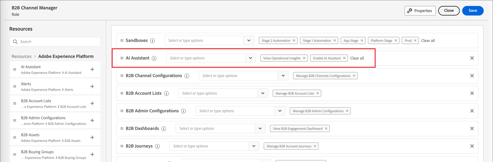

# 启用AI访问

>[!IMPORTANT]
>
>如果您在权限UI中收到一条消息，告知您组织必须首先同意其他法律条款才能访问[!DNL Coworker]聊天，请联系您的Adobe客户团队以获取指导。

使用[权限UI](https://experienceleague.adobe.com/en/docs/experience-platform/access-control/abac/permissions-ui/permissions){target="_blank"}授予或撤销对组织中聊天[!DNL Coworker]的访问权限。 要使用[!DNL Coworker]聊天，给定用户必须属于配置了&#x200B;_[!UICONTROL 启用AI助手]_&#x200B;和&#x200B;_[!UICONTROL 查看操作分析]_&#x200B;权限的角色。

作为管理员，您可以：

* 将&#x200B;**[!UICONTROL 启用AI助手]**&#x200B;权限添加到给定角色，并将用户添加到该角色。 此权限允许您组织中的用户访问[!DNL Coworker]聊天。

* 将&#x200B;**[!UICONTROL 查看运营分析]**&#x200B;权限添加到给定角色，并将用户添加到该角色。 此权限允许用户使用[!DNL Coworker]聊天操作分析功能。

{width="800" zoomable="yes"}

使用权限UI授予在[!DNL Adobe Journey Optimizer B2B Edition]中使用[!DNL Coworker]聊天的权限。 有关访问[!DNL Adobe Experience Platform]和其他[!DNL Adobe Experience Cloud]应用程序中的[!DNL CX Coworker]的信息，请参阅[CX Enterprise Coworker文档](https://experienceleague.adobe.com/en/docs/coworker/content/chat/overview){target="_blank"}。

当用户具有必要的权限时，他们可以通过选择应用程序顶部标题上的&#x200B;_[!DNL Coworker]聊天_&#x200B;图标来访问[!DNL Coworker]聊天。

应用程序标头](./assets/coworker-icon-header.png){width="800" zoomable="yes"}中的![[!DNL Coworker]聊天图标
