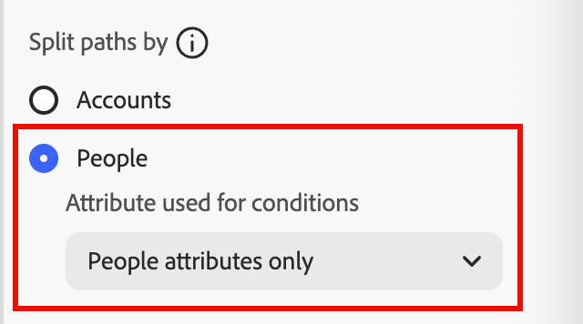

# 在历程中使用人员列表

您可以通过多种方式将[人员列表](./people-lists.md)合并到您的帐户历程和人员历程中：

* **维护历程中的静态列表** — 在&#x200B;_执行操作_&#x200B;节点中，使用&#x200B;_[!UICONTROL 添加到人员列表]_&#x200B;或&#x200B;_[!UICONTROL 从人员列表中删除]_&#x200B;操作在人员经过历程时更新静态人员列表的成员资格。
* **根据列表成员资格路由人员** — 在&#x200B;_拆分路径_&#x200B;节点中，使用&#x200B;_[!UICONTROL 人员静态列表的人员成员]_&#x200B;或&#x200B;_[!UICONTROL 人员动态列表的人员成员]_&#x200B;筛选器为是（或不是）列表成员的人创建路径。

例如，您可以构建团队成员和合作伙伴的排除列表，并使用该列表从培养路径中排除这些人员。 或者，当人员在一个历程中到达资格点时，您可以将他们添加到静态列表，然后使用该列表在其他历程中分支人员。

## 执行操作节点 — 添加到人员列表 {#add-to-people-list}

**_仅静态联系人列表_**

在帐户或人员历程中，使用[a _执行操作_&#x200B;节点](../journeys/action-nodes.md#people-actions)将人员添加到静态人员列表。

例如，考虑一个历程路径，您在该路径下发送电子邮件，有些人注册了网络研讨会。 您将此响应视为历程中的资格点。 根据资格，您希望将这些人员添加到静态人员列表，其他历程将合格人员拆分为不同路径。

>[!NOTE]
>
>如果执行节点时列表中已存在人员，则该操作将被忽略。

1. 导航到历程图。

1. 单击路径上的加号( **+** )图标，然后选择&#x200B;**[!UICONTROL 执行操作]**。

1. （仅限帐户历程）Select ]_上的_[!UICONTROL &#x200B;操作&#x200B;**[!UICONTROL 人员]**&#x200B;选项。

1. 若要对联系人执行&#x200B;_[!UICONTROL 操作]_，请选择&#x200B;**[!UICONTROL 添加到联系人列表]**。

1. 对于&#x200B;**[!UICONTROL Select静态人员列表]**，选择要添加人员的人员列表。

   {width="300"}

## 执行操作节点 — 从人员列表中删除 {#remove-from-people-list}

**_仅静态联系人列表_**

在帐户或人员历程中，使用[a _执行操作_&#x200B;节点](../journeys/action-nodes.md#people-actions)从静态人员列表中删除人员。

例如，在人员转化后，您要将他们从静态列表中移除。 这个列表用来将人们引导到培养路径上，这样他们就不会再接受培养通信。

>[!NOTE]
>
>如果人员不在计划从中将其删除的列表中，则该操作将被忽略。

1. 导航到历程图。

1. 单击路径上的加号( **+** )图标，然后选择&#x200B;**[!UICONTROL 执行操作]**。

1. （仅限帐户历程）Select ]_上的_[!UICONTROL &#x200B;操作&#x200B;**[!UICONTROL 人员]**&#x200B;选项。

1. 若要对联系人执行&#x200B;_[!UICONTROL 操作]_，请选择&#x200B;**[!UICONTROL 从联系人列表中删除]**。

1. 对于&#x200B;**[!UICONTROL Select静态人员列表]**，选择要从中删除人员的人员列表。

   {width="300"}

## 拆分路径节点 — 人员列表的成员 {#split-paths-by-list-membership}

**_帐户和人员历程_**

在&#x200B;[_拆分路径_&#x200B;节点](../journeys/split-merge-paths-nodes.md)中使用人员列表成员资格筛选器，根据人员是否为人员列表的成员来路由人员。 提供了两个过滤器：

| 过滤器 | 描述 |
| ------ | ----------- |
| [!UICONTROL 人员动态列表的成员] | 人员是否属于一个或多个动态人员列表。 成员资格反映列表的当前规则。 |
| [!UICONTROL 人员静态列表的成员] | 此人是否属于一个或多个静态人员列表。 |

这些过滤器在两种历程类型中均可用：

* **人员历程** — 在&#x200B;_拆分路径_&#x200B;节点中。
* **帐户历程** — 在由&#x200B;_[!UICONTROL 人员]_&#x200B;拆分的&#x200B;_拆分路径_&#x200B;节点中。

要从培养路径中排除团队成员和合作伙伴，请添加&#x200B;_[!UICONTROL 人员静态列表的人员]_&#x200B;筛选器，将运算符设置为`is not`，然后选择列表。

1. 导航到历程图。

1. 单击路径上的加号( **+** )图标，然后选择&#x200B;**[!UICONTROL 拆分路径]**。

   {width="300" zoomable="no"}

1. （仅限帐户历程）为人员条件设置节点。

   * 在右侧的节点属性中，为拆分选择&#x200B;**[!UICONTROL 人员]**。

   * 将用于条件&#x200B;]**的**[!UICONTROL &#x200B;属性设置为仅&#x200B;**[!UICONTROL 人员属性]**。

   {width="300" zoomable="no"}

1. 要为&#x200B;_[!UICONTROL 路径1]_&#x200B;定义条件，请单击&#x200B;**[!UICONTROL 应用条件]**。

1. 在条件编辑器中，展开&#x200B;_[!UICONTROL 特殊筛选器]_&#x200B;文件夹，并将&#x200B;**[!UICONTROL 人员动态列表的人员成员]**&#x200B;或&#x200B;**[!UICONTROL 人员静态列表的人员成员]**&#x200B;筛选器拖动到条件工作区。

   {width="700" zoomable="yes"}

1. 要包含列表成员，请将成员资格设置为`is`。

   要排除这些人，请将其设置为`is not`。

1. Select要评估的人员列表。

   在字段中输入文本以筛选可用列表。 只有用户创建的人员列表可供选择。

1. 通过在顶部应用&#x200B;**[!UICONTROL 筛选器逻辑]**&#x200B;优化条件。

   您可以将列表成员资格筛选器与其他人员筛选器组合，并选择匹配所有条件或任何条件。

1. 单击&#x200B;**[!UICONTROL 完成]**。

继续配置拆分路径节点，如&#x200B;[_按人员添加拆分路径_](../journeys/split-merge-paths-nodes.md#add-a-split-path-by-people-node)&#x200B;中所述。 有关成员资格筛选器的详细信息，请参阅&#x200B;[_成员资格筛选_](../journeys/split-merge-paths-nodes.md#membership-filtering)。
