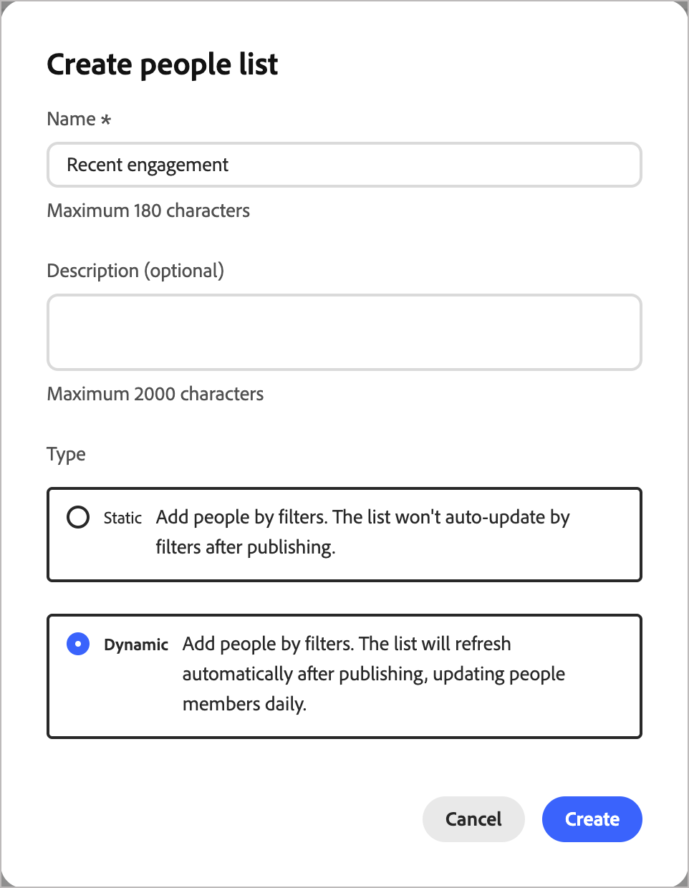

# 人员列表

在[!DNL Journey Optimizer B2B Edition]中，人员列表是指定的人员配置文件集合，您可以在历程中重复使用。 不要在每个历程中重新创建相同的过滤器集，而是一次性定义人员组并在您需要时随时引用它。 例如，使用人员列表从培养历程中排除内部员工或现有客户，或者跟踪在一个历程中完成某个步骤的人员，以便另一个历程可以对其执行操作。

人员列表有两种类型：

* **[!UICONTROL 静态]** — 仅当您明确添加或删除人员时，成员身份才会更改。 您可以通过应用过滤器集来根据当前人员数据填充列表来添加人员，或通过帐户或人员历程添加和删除人员。 查看[静态联系人列表](./people-lists-static.md)。
* **[!UICONTROL 动态]** — 您定义了一组用于自动策划列表的规则（筛选器）。 列表会在用户符合或不符合规则定义资格时动态刷新。 查看[动态联系人列表](./people-lists-dynamic.md)。

您可以[在帐户历程和人员历程中使用人员列表](./people-lists-journeys.md)根据列表成员资格拆分路径，并向静态列表中添加人员或从静态列表中删除人员。

>[!NOTE]
>
>人员列表包括已在[!DNL Journey Optimizer B2B Edition]中同步和可用的人员配置文件。 评估列表时，不会直接从[!DNL Adobe Experience Platform]受众中读取用户档案。

## 访问和浏览人员列表 {#access-browse}

从左侧导航栏访问人员列表，以查看、创建和管理列表成员资格。

>[!AVAILABILITY]
>
>以下产品权限可控制对人员列表的访问：
>
>* [!UICONTROL 管理B2B人员列表] — 查看、创建、编辑和删除人员列表。
>* [!UICONTROL 查看B2B人员列表] — 查看人员列表及其成员（只读）。
>
>有关分配权限的信息，请参阅[用户访问和权限](../admin/user-management.md#b2b-product-permissions)。

* 在左侧导航栏中，展开&#x200B;**[!UICONTROL 帐户]**&#x200B;并选择&#x200B;**[!UICONTROL 人员列表]**。

* Select **[!UICONTROL 动态列表]**&#x200B;或&#x200B;**[!UICONTROL 静态列表]**&#x200B;以在这两种列表类型之间切换。

* 在列表顶部的&#x200B;_搜索_&#x200B;字段中输入文本，以按名称筛选显示的列表。

  {width="800" zoomable="yes"}

* 单击右上角的&#x200B;_列设置_ （ ）图标以选择或清除显示的列。

* 要更改列的宽度，请拖动列标题之间的分隔线。

每个选项卡都包含&#x200B;**[!UICONTROL Name]**、**[!UICONTROL Last updated]**、**[!UICONTROL Updated by]**、**[!UICONTROL Created on]**&#x200B;和&#x200B;**[!UICONTROL Created by]**&#x200B;列。 单击人员列表名称可查看其详细信息。

在此页中，您还可以：

* 创建新的动态和静态列表。
* 打开列表并[审阅当前成员](#view-list-members)。
* 单击列表的&#x200B;_更多操作_ ( **...** )图标，然后选择[编辑](#edit-list-properties)或[删除](#delete-people-list)。

## 创建人员列表 {#create-people-list}

1. 单击&#x200B;_[!UICONTROL 人员列表]_&#x200B;页面右上角的&#x200B;**[!UICONTROL 创建列表]**。

   {width="450"}

1. 输入列表的&#x200B;**[!UICONTROL Name]**（必需）和&#x200B;**[!UICONTROL Description]**（可选）。

   该名称最多可包含180个字符，并且在相同类型的列表中必须是唯一的。 描述最多可包含2,000个字符。

1. 选择列表&#x200B;**[!UICONTROL 类型]**：

   * [**[!UICONTROL 静态]**](./people-lists-static.md) — 资格筛选器决定您将其应用于列表时的成员资格。 仅当您手动添加人员或历程添加或删除人员时，成员资格才会更新。
   * [**[!UICONTROL 动态]**](./people-lists-dynamic.md) — 资格筛选器动态确定成员资格。 成员资格会自动刷新。

1. 单击&#x200B;**[!UICONTROL 创建]**。

   新人员列表将在其详细信息页面上打开，过滤器编辑器将打开，以便您能够为列表定义人员。 要将人员添加到静态列表，请应用一个或多个筛选器。 对于动态列表，定义列表成员资格的规则。

## 查看列表成员 {#view-list-members}

在人员列表的详细信息页面上，**[!UICONTROL 成员]**&#x200B;列表显示列表中的人员。 列表中的总人数显示在表的顶部。

成员表包含以下列：

* **[!UICONTROL 名称]**
* **[!UICONTROL 电子邮件地址]**
* **[!UICONTROL 职务]**
* **[!UICONTROL 公司]**
* **[!UICONTROL 已取消订阅]**
* **[!UICONTROL 创建于]**
* **[!UICONTROL 上次修改时间]**

默认情况下，系统会按&#x200B;**[!UICONTROL 上次修改时间]**&#x200B;对成员进行排序，首先显示最近修改的人员。 您还可以按&#x200B;**[!UICONTROL 名称]**、**[!UICONTROL 电子邮件地址]**&#x200B;或&#x200B;**[!UICONTROL 创建日期]**&#x200B;进行排序。

* 要查找特定成员，请使用&#x200B;_搜索_&#x200B;字段。 您可以按名字、电子邮件地址或公司进行搜索。
* 要选择要显示的列，请单击&#x200B;_列设置_&#x200B;图标，然后选中或清除复选框。 将始终显示&#x200B;_[!UICONTROL Name]_&#x200B;列。
* 若要查看最新的成员资格，请使用&#x200B;_[!UICONTROL 更多]_&#x200B;菜单选择&#x200B;**[!UICONTROL 刷新成员]**。
* 要查看有关人员的详细信息，请单击此人员的姓名以打开[人员详细信息](../accounts/person-details.md)页面，您可以在此页面查看其摘要和最近的活动。

## 编辑人员列表属性 {#edit-list-properties}

您可以更改静态或动态人员列表的名称和描述。

1. 使用以下方法之一打开&#x200B;_[!UICONTROL 编辑列表]_&#x200B;对话框：

   * 在&#x200B;_[!UICONTROL 人员列表]_&#x200B;页面上，单击列表的&#x200B;_更多操作_ (**...** )图标，然后选择&#x200B;**[!UICONTROL 编辑]**。
   * 在列表的详细信息页面上，单击&#x200B;**[!UICONTROL 编辑列表属性]**。

1. 更新&#x200B;**[!UICONTROL Name]**&#x200B;或&#x200B;**[!UICONTROL Description]**。

1. 单击&#x200B;**[!UICONTROL 保存]**。

## 删除人员列表 {#delete-people-list}

>[!IMPORTANT]
>
>删除人员列表是永久性的，无法撤消。 您无法删除活动历程正在使用的人员列表。

1. 使用以下方法之一删除列表：

   * 在&#x200B;_[!UICONTROL 人员列表]_&#x200B;页面上，单击列表名称旁边的&#x200B;_更多操作_ (**...**)图标，然后选择&#x200B;**[!UICONTROL 删除]**。
   * 在列表的详细信息页面上，单击&#x200B;**[!UICONTROL 删除列表]**。

1. 在确认对话框中单击&#x200B;**[!UICONTROL 删除]**。
