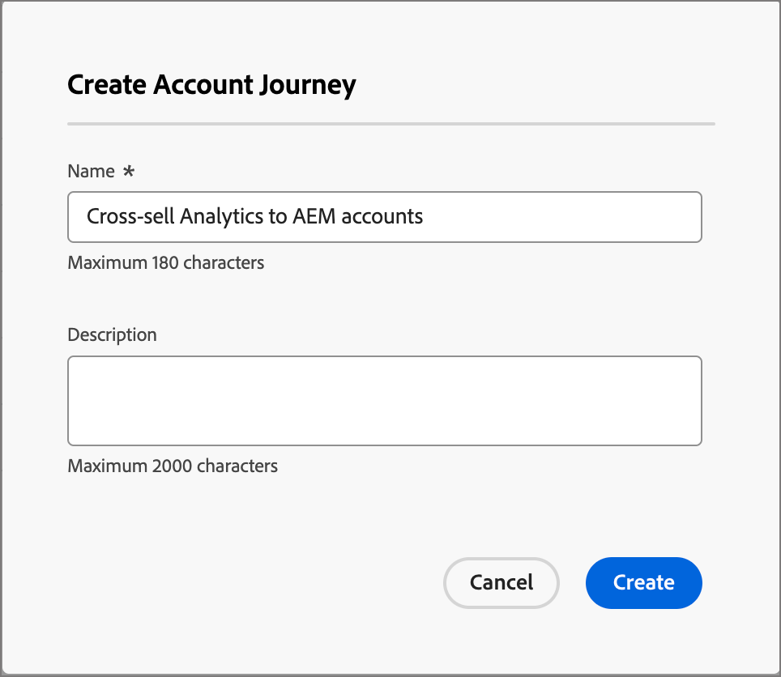
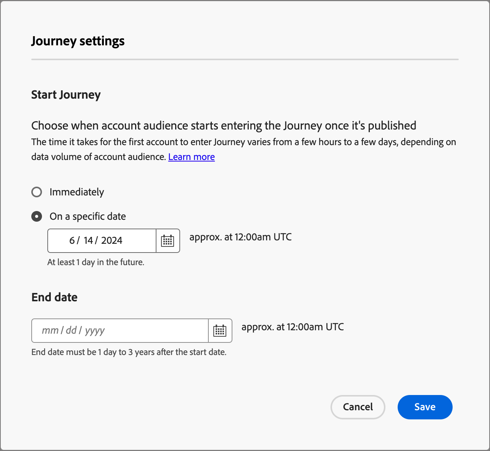
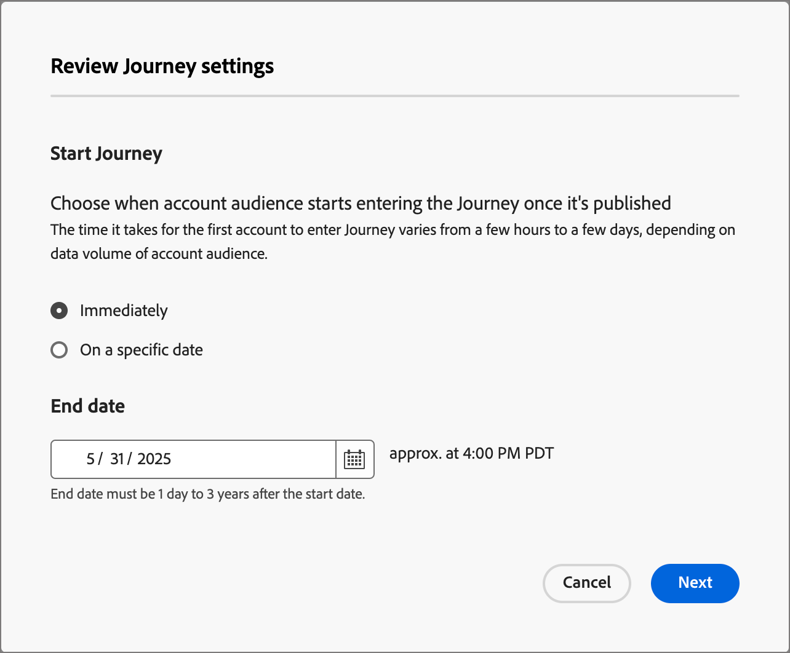

# 构建和发布历程

要开始新历程，请创建历程，然后在历程图中构建节点和历程流。

{width="30"} [观看概述视频](#overview-video)

## 创建历程

在左侧导航栏中的&#x200B;**[!UICONTROL 历程管理]**&#x200B;下，选择要创建的历程类型：

* **[!UICONTROL 帐户历程]**
* **[!UICONTROL 人员历程]**

添加新历程(_T):_

+++帐户历程

1. 单击页面右上角的&#x200B;**[!UICONTROL 创建帐户历程]**。

1. 在对话框中，输入唯一的&#x200B;**[!UICONTROL Name]**（必需）和&#x200B;**[!UICONTROL Description]**（可选）。

   {width="400"}

1. 单击&#x200B;**[!UICONTROL 创建]**。

+++

+++人员历程

1. 单击页面右上角的&#x200B;**[!UICONTROL 创建历程]**。

1. 在对话框中，输入唯一的&#x200B;**[!UICONTROL Name]**（必需）和&#x200B;**[!UICONTROL Description]**（可选）。

   {width="400"}

1. 单击&#x200B;**[!UICONTROL 创建]**。

+++

## 历程设计的组件

_历程图_&#x200B;是历程工作区的中心区域。 在此区域中，您可以添加并配置历程节点。 单击某个节点可打开其位于画布右侧的属性窗格，并根据您的设计设置这些窗格。 历程始终以受众节点开始，您可以在其中定义历程的输入：

* [帐户受众节点](./account-audience-nodes.md)
* [人员受众节点](./person-audience-nodes.md)

创建帐户历程并添加受众后，使用节点设计历程。 历程图提供了一个画布，您可以在其中使用以下节点类型构建多步骤B2B营销用例以构建帐户历程：

* [执行操作](./action-nodes.md)
* [侦听事件](./listen-for-event-nodes.md)
* [拆分路径](./split-merge-paths-nodes.md)
* [变体拆分路径](./variant-split-paths-nodes.md)
* [下一个最佳路径](./next-best-path-node.md)
* [等待](./wait-nodes.md)
* [合并路径](./split-merge-paths-nodes.md)

## 护栏

为了帮助您构建旅程而不会遇到错误，已设置以下防护：

* _删除拆分路径节点_：删除节点需要删除每个路径中的所有后续节点。
* _删除合并节点_：仅当有一个路径连接到该合并节点时，才能删除该合并节点。 要删除合并节点，请仅保留一个选定的路径。
* _在帐户和人员之间切换_：将选择从帐户更改为人员将删除每个路径中的所有后续节点。

## 添加节点

1. 导航到历程图。

1. 单击路径上的加号( **+** )图标并选择节点类型。

   {width="400" zoomable="no"}

   可用的节点类型取决于历程类型和路径上下文。 有关详细信息，请参阅&#x200B;[_历程节点_](./journey-nodes.md)。

1. 设置右侧的节点属性。

   属性取决于节点类型。

## 标记节点 {#label-a-node}

在[!DNL Adobe Journey Optimizer B2B Edition]中，历程映射中的每个节点都显示其默认名称，如&#x200B;_等待_&#x200B;或&#x200B;_发送电子邮件_。 添加显示标签以区分相同类型的节点并识别每个步骤的目的。 例如，使用&#x200B;_48小时冷却_&#x200B;或&#x200B;_欢迎电子邮件_。

您可以向帐户历程或人员历程中的任何节点添加显示标签。

1. 在历程映射中，选择要标记的节点。

1. 在节点属性中，在&#x200B;**[!UICONTROL 显示标签]**&#x200B;字段中输入文本。

   标签最多可包含255个字符。

1. 单击字段外部以应用标签。

   {width="500" zoomable="no"}

   标签取代了历程映射中节点上的默认名称。

要恢复默认名称，请清除&#x200B;**[!UICONTROL 显示标签]**&#x200B;字段并单击该字段外部。

发布历程时，每个节点的显示标签将随发布的历程一起保存。

>[!NOTE]
>
>显示标签不适用于在此功能可用之前创建的历程中的节点。

节点标签在`AJOB2B - 1.5.4 - journey node`架构和`AJOB2B-1_5_4-journey_node`数据集中可用。 您可以在[!DNL Adobe Experience Platform]中查询标签并将它们用于[!DNL Adobe Customer Journey Analytics]中的报告。 有关查询导出数据的详细信息，请查看[数据集查询先决条件](../data/aep-query-examples.md#prerequisites)。

## 删除节点

1. 导航到历程图。

1. 在右侧的节点属性中，单击&#x200B;_删除_ （  ）图标。

1. 在确认对话框中单击&#x200B;**[!UICONTROL 删除]**。

## 添加和删除路径

1. 在历程图中，单击路径上的加号( **+** )图标，然后添加[拆分路径节点](./split-merge-paths-nodes.md#split-paths)。

1. 在右侧的节点属性中，选择&#x200B;**[!UICONTROL 帐户]**。

1. 要添加更多路径，请单击&#x200B;**[!UICONTROL 添加路径]**。

   对于历程中创建的每个路径，属性中都会显示一张新路径卡。

1. 导航到历程中的路径之一，并使用加号图标将[action](./action-nodes.md)或[event](./listen-for-event-nodes.md)节点添加到该路径。

1. 选择[拆分路径](./split-merge-paths-nodes.md)节点以打开右侧的属性。

   无法删除包含节点的路径。

1. 要删除路径，必须先删除该路径上的所有节点。

## 计划历程

发布历程时，历程可以立即开始，也可以在计划的未来日期开始。 结束日期最多可以为从开始日期起三年。 发布历程后（_实时_&#x200B;状态），您可以更新历程的结束日期，但不能更新开始日期。

1. 导航到历程图。

1. 单击标题中的&#x200B;**[!UICONTROL 历程设置]**&#x200B;以计划您的旅程。

1. 在对话框中，设置计划选项：

   * 选择计划类型。

     要在发布时激活历程，请选择&#x200B;**[!UICONTROL 立即]**。

     要在将来的某个日期激活历程，请选择&#x200B;**[!UICONTROL 在特定日期]**，然后单击&#x200B;_日历_&#x200B;图标以选择日期。

     {width="400" zoomable="no"}

   * 指定历程的&#x200B;**[!UICONTROL 结束日期]**。 从开始日期起最多可以为三年（发布时需要此字段）。

1. 单击&#x200B;**[!UICONTROL 保存]**。

   当您准备好发布历程时，您可以在单击&#x200B;_[!UICONTROL 发布]_&#x200B;时查看这些设置。

## 发布历程

如果没有阻止程序错误，则可以发布历程。 发布后，历程状态更改为&#x200B;_实时_。 如果历程有错误，_[!UICONTROL 发布]_&#x200B;按钮将灰显，内容信息为： `Resolve errors before publishing`。

>[!NOTE]
>
>发布帐户历程后，符合条件的帐户进入历程会有长达24小时的延迟。

1. 在历程图的右上方，单击&#x200B;**[!UICONTROL 发布]**。

1. 在&#x200B;_[!UICONTROL 查看历程设置]_&#x200B;对话框中，设置历程开始选项。

   如果已设置历程设置来定义计划，请查看设置。

   如果需要设置历程激活，请选择计划类型：

   * 要在发布时激活历程，请选择&#x200B;**[!UICONTROL 立即]**。

   * 要在将来的某个日期激活历程，请选择&#x200B;**[!UICONTROL 在特定日期]**，然后单击&#x200B;_日历_&#x200B;图标以选择日期。

1. 如果需要，请为历程指定&#x200B;**[!UICONTROL 结束日期]**。

   {width="400" zoomable="no"}

   从开始日期起最多可以为三年（发布时需要此字段）。

1. 单击&#x200B;**[!UICONTROL 下一步]**。

1. 在确认对话框中，单击&#x200B;**[!UICONTROL 发布]**。

## 概述视频

>[!VIDEO](https://video.tv.adobe.com/v/3443229/?captions=chi_hans&learn=on)
