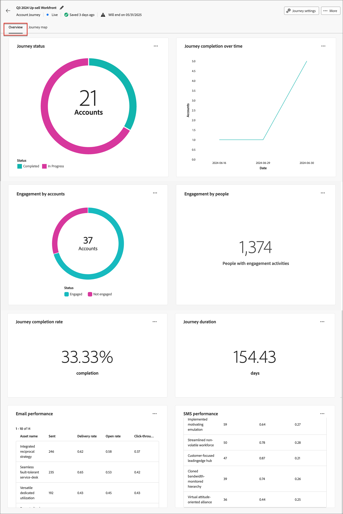

# 历程详细信息

在[!DNL Adobe Journey Optimizer B2B Edition]中，打开已发布的帐户或人员历程，然后选择&#x200B;**[!UICONTROL 概述]**&#x200B;选项卡。 查看所选历程的进度、参与度和渠道性能。

帐户历程报告帐户的进度。 人员历程报告人员的进度。 可用的小部件和量度标签因历程类型而异。 选择仪表板详细信息的相应选项卡。

对于在历程中聚合的电子邮件量度，请使用[电子邮件性能报表](../dashboards/email-performance-dashboard.md)。

>[!BEGINTABS]

>[!TAB 帐户历程]

帐户历程仪表板显示帐户进度、参与度、渠道性能和创作AI摘要。 数据大约需要四个小时才能开始填充到图表和表中。

{width="700" zoomable="yes"}

## 历程完成

本节介绍两个完成指标：

* **[!UICONTROL 历程中的帐户状态]**：显示帐户总数以及按历程状态细分，包括&#x200B;_已完成_、_进行中_&#x200B;和&#x200B;_已中止_。 每个区段显示状态、百分比和帐户计数。
* **[!UICONTROL 随时间变化的已完成帐户]**：显示一段时间内完成历程的帐户数。 水平轴显示日期，垂直轴显示帐户计数。

>[!NOTE]
>
>在帐户历程中，历程&#x200B;]**图表中的**[!UICONTROL &#x200B;帐户状态包含经过历程的帐户，即使这些帐户随后被删除也是如此。 **[!UICONTROL 穿透钻取]**&#x200B;不包括已删除的帐户，因此它显示的记录比图表少。 这一差异是意料之中的。 删除帐户不会更改历史历程状态计数。

## 历程参与

本节介绍两个参与量度：

* **[!UICONTROL 帐户参与次数]** — 此圆环图将历程中的帐户划分为&#x200B;_参与次数_&#x200B;和&#x200B;_未参与次数_&#x200B;类别。 中心图显示总数。 此可视化图表有助于快速了解总体客户参与情况。
* **[!UICONTROL 参与者的参与度]**：显示历程中参与活动的人数。 此值计入人员而非参与活动。

## 历程性能

本节介绍两个重要的量度：

* **[!UICONTROL 历程完成率]** — 已成功完成其旅程的帐户的百分比。
* **[!UICONTROL 平均历程完成时间]**：帐户完成历程所用的平均时间（以天为单位）。

## 渠道性能 {#email-and-sms-performance}

仪表板包括所选帐户历程的&#x200B;**[!UICONTROL 电子邮件性能]**、**[!UICONTROL 短信性能]**&#x200B;和&#x200B;**[!UICONTROL WhatsApp性能]**&#x200B;表。 使用可用的投放和参与量度评估每个通信接触点。

**[!UICONTROL 电子邮件性能]**&#x200B;表列：

* _[!UICONTROL 资源名称]_ — 资源的名称
* _[!UICONTROL 已发送]_ — 已发送的电子邮件数
* _[!UICONTROL 投放率]_ — 已投放电子邮件数除以已发送数量
* _[!UICONTROL 打开率]_ — 已打开电子邮件的数量除以投放的数量
* _[!UICONTROL 点进率]_ — 点击电子邮件数除以发送数量

**[!UICONTROL SMS性能]**&#x200B;表列：

* _[!UICONTROL 资源名称]_ — 资源的名称
* _[!UICONTROL 已发送]_ — 已发送的短信消息数
* _[!UICONTROL 投放率]_ — 已投放的短信消息数除以已发送数量
* _[!UICONTROL 点进率]_ — 点击短信消息数除以投放数量
<!--
To generate a shareable PDF of your current view, click **[!UICONTROL Export]** at the top right of the page. 
-->

## 其他操作

使用图表或表的&#x200B;**...**&#x200B;菜单访问其可用操作。

### 穿透钻取

对于历程&#x200B;]**图表中的**[!UICONTROL &#x200B;帐户状态，请选择&#x200B;**[!UICONTROL 穿透钻取]**&#x200B;以深入分析各个帐户状态。

{width="600" zoomable="yes"}
<!--
The applied global filters are carried over to the view and displayed at the top. Click the _Filter_ icon at the top left to filter the data display by journey.
-->

### 查看更多信息

选择&#x200B;**[!UICONTROL 查看更多]**&#x200B;以访问扩展数据。 显示的弹出窗口提供数据的细分。

{width="600" zoomable="yes"}

要下载数据，请选择&#x200B;**[!UICONTROL 下载CSV]**。 要返回&#x200B;_[!UICONTROL 概述]_&#x200B;仪表板，请选择&#x200B;**[!UICONTROL 关闭]**。

>[!TAB 人员历程]

人员历程仪表板显示选定历程中人员的完成、参与和电子邮件性能。

{width="700" zoomable="yes"}

## 历程完成 {#person-journey-completion}

请使用以下图表查看历程中人员的状态和完成趋势：

* **[!UICONTROL 历程中的人员状态]**：显示人员总数并按历程状态细分。 每个区段显示状态、百分比和人员计数。
* **[!UICONTROL 随时间变化的已完成人数]**：显示一段时间内完成历程的人数。 **[!UICONTROL 增量已完成]**&#x200B;系列显示每个时间间隔的完成。 **[!UICONTROL 累计已完成]**&#x200B;系列显示正在运行的完成总数。

>[!NOTE]
>
>在个人历程中，历程中&#x200B;**[!UICONTROL 人员的状态]**&#x200B;图表包含经过该历程的人员，即使他们后来被删除。 **[!UICONTROL 穿透钻取]**&#x200B;不包括已删除的人员，因此它显示的记录比图表少。 这一差异是意料之中的。 删除人员不会更改历史历程状态计数。

对于历程]图表中人员的&#x200B;_[!UICONTROL 状态，请单击_&#x200B;更多_ (**...**)图标，然后选择&#x200B;**[!UICONTROL 穿透钻取]**&#x200B;以查看个人状态。

## 历程参与 {#person-journey-engagement}

**[!UICONTROL 人员参与度]**&#x200B;小组件显示历程中具有参与活动的人员数。 此值计入人员而非参与活动。

## 历程性能 {#person-journey-performance}

请使用以下量度来复查完成性能：

* **[!UICONTROL 历程完成率]**：完成旅程的人员百分比。
* **[!UICONTROL 平均历程完成时间]**：人员完成历程所用的平均时间（以天为单位）。

## 电子邮件绩效 {#person-journey-email-performance}

**[!UICONTROL 电子邮件性能]**&#x200B;表显示选定人员历程中每个电子邮件资源的计数，而不是费率：

* **[!UICONTROL 资源名称]**：电子邮件资源的名称
* **[!UICONTROL 已发送]**：已发送的电子邮件数
* **[!UICONTROL 已传递]**：已传递的电子邮件数
* **[!UICONTROL 已打开]**：已打开的电子邮件数
* **[!UICONTROL 已点击]**：已点击的电子邮件数

>[!ENDTABS]
