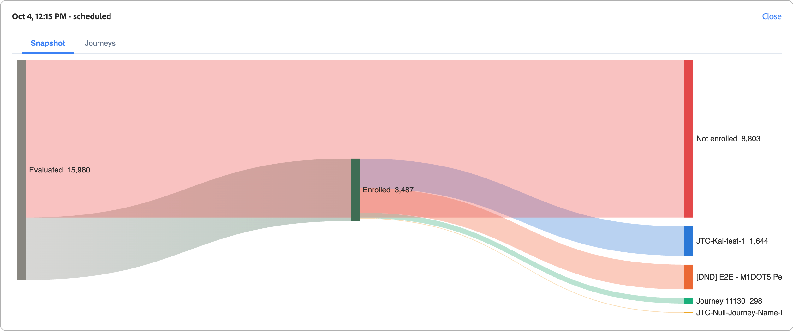

# 历程流量控制

在[!DNL Adobe Journey Optimizer B2B Edition]中，受众经常重叠。 金融服务公司的营销总监可以在同一天获得您的行业历程、产品兴趣历程和企业帐户历程的资格。 如果没有协调，该人员将注册所有这三项功能，并接收竞争或冗余消息。 使用&#x200B;_历程流量控制_&#x200B;将每个人在同时符合多个历程的资格时，以最适合的方式注册到同一个历程中。

历程流量控制会审核符合多个参与旅程条件的每个人。 它会根据每个历程目的比较您对人员的了解，并将人员登记到最佳匹配。 仅符合一个历程资格的用户已注册该历程。 符合无资格的人员不会被注册。

## 历程流量控制的好处 {#benefits}

历程流量控制将手动重叠管理替换为为每个人记录的、基于契合度的决策。

| 无历程流量控制 | 使用历程流量控制 |
|---|---|
| 匹配多个受众的人员已注册多个历程并接收重叠消息。 | 每个人员最多可注册一次参与历程，以进行每次评估。 |
| 团队可手动管理与排除区段和受众规则的重叠。 每一次新旅程，这些规则都更难维护。 | 系统根据适应度进行选择。 您不构建或维护排除逻辑。 |
| 很难解释一个人为什么会得到一段特定的旅程。 | 每个决策都将被记录并可查看，包括每个竞争历程的分数。 |
| 消息疲劳和混合消息传递降低了参与度。 | 每个人都会获得一种相关、一致的体验。 |

## 使用示例 {#examples}

当您的旅程针对重叠受众时，请使用旅程流量控制。 例如：

* **行业培养计划**：您为金融服务、医疗保健和制造业分别运行不同的历程。 联系人没有行业价值，但其个人资料与银行账户相关联。 历程流量控制将联系人匹配到Financial Services历程，而不是在所有三个历程中注册他们。
* **产品兴趣营销活动**：您为每个产品线运行一个历程。 具有两个产品的最新兴趣信号的前景客户已注册具有最强烈兴趣的产品的历程。
* **基于角色的消息**：您运行一个技术评估人员历程，另一个执行发起人历程。 人员的工作职称和职能决定了其加入的历程。
* **企业程序和SMB程序**：您按公司规模运行不同的历程。 联系人的客户区段和帐户信息决定他们加入哪个历程。
* **新历程启动**：您将新历程发布到其他历程已涵盖的受众。 历程流量控制会评估重叠，这样就不会重新设计现有的受众规则。

## 根据适应度选择 {#dimensions}

当人员符合多个历程的资格条件时，历程流量控制会将人员的配置文件与每个候选历程的名称和描述进行比较。 比较涵盖四个维度。

| 维度 | 比较内容 |
|---|---|
| 行业 | 人员的行业。 如果行业缺失，则关联帐户的行业。 |
| 功能拟合 | 人员的角色和工作职能。 |
| 公司规模 | 人员的客户区段、帐户类型和支出上下文。 |
| 意图 | 个人最近最感兴趣的产品。 |

请牢记以下几点：

* **历程名称和描述很重要。** 它们告诉系统每个历程的目的。 具体而准确的描述会产生更好的匹配。
* **跳过缺少的数据，没有猜到。** 如果人员没有维度值，则历程流量控制会为该人员保留该维度。 它针对包含数据的维度做出决策。

报告视图中的每个人的决策记录显示每个竞争历程的分数和使用的维度。 没有数据的维度将被标记为已排除。

### 比较 {#comparisons}

对于每个维度，历程流量控制会将人员的相关文本（例如职务）与每个历程的描述进行比较。 它使用两种方法：

* **表示相似性**：文本是否表示与描述接近的内容？
* **关键字匹配**：文本是否使用与描述相同的术语？

这两种方法的强大结果将成为该维度的历程分数。

然后，每个维度会建议其最佳评分历程，但前提是得分清除最小质量阈值。 没有合格计划书的历程将被丢弃。 您配置的权重会根据其合并的加权得分对剩余旅程进行排名。 选择得分最高的历程。 获胜者不一定是提议最多的历程。 单个维度中的一个强匹配比多个较弱匹配更重要。

每个决策记录存储以下信息：

* 所选历程和竞争历程
* 每个维度的得分和组合分数
* 置信度值
* 协议级别为“高”、“Medium”或“低”，它显示支持入选者的维度数量

<!-- CONFIRM with Engineering: whether to describe the fallback when no dimension produces a qualifying match. The source says the person is still enrolled in one eligible journey, selected consistently, with a 0% (Low) confidence decision record. Also confirm how "consistent" should be phrased. -->

## 配置 {#configuration}

要设置历程流量控制维度权重并模拟评分，请执行以下操作：

1. 在左侧导航中，转到&#x200B;**[!UICONTROL 历程管理]** > **[!UICONTROL 历程流量控制]**。

1. 选择&#x200B;**[!UICONTROL 配置]**&#x200B;选项卡。

{width="800" zoomable="yes"}

### 调整维度权重 {#weights}

默认情况下，所有四个维度的权重均为&#x200B;_Medium_，且每个维度的贡献均等，均为25%。 调整权重可更改每个维度对决策的影响程度。

1. 对于每个维度，设置加权级别：

   * **[!UICONTROL 关]**
   * **[!UICONTROL 低]**
   * **[!UICONTROL Medium]**
   * **[!UICONTROL 高]**

   每张信息卡上的百分比显示合并设置后该维度的份额。 要从决策中删除维度，请将其设置为&#x200B;**[!UICONTROL 禁用]**。

   {width="600"}

   每张卡片上显示的百分比是该维度在组合所有选择后的标准化贡献，总和为100%。 如果增加一个尺寸，系统会自动将其它尺寸重新标准化，使总尺寸保持在100%。

   您可以单击&#x200B;**[!UICONTROL 重置为等于]**&#x200B;以返回所有维度的均等权重。

1. 如果要应用调整后的权重，请选择&#x200B;**[!UICONTROL 保存权重]**。

   >[!NOTE]
   >
   >若要保存对维度权重所做的更改，您必须具有&#x200B;_[!UICONTROL 管理B2B管理员配置]_ [产品权限](../admin/user-management.md#b2b-product-permissions)。

### 模拟评分 {#simulate-scoring}

在将权重提交到生产环境之前，您可以模拟流量控制在这些更改下的行为。 模拟不需要启用历程流量控制。 它会评估实时历程中已存在的用户档案，并将流量控制逻辑应用于这些用户档案。 然后，您可以判断结果是否与权重设置相符。

单击&#x200B;**[!UICONTROL 模拟评分]**。

结果标题汇总了运行：

* **已评估用户档案** — 已评分的用户档案数以及历程数。
* **平均冲突/配置文件** — 每个配置文件的平均竞争历程数。
* **平均匹配得分** — 所选历程的平均置信度。

{width="700" zoomable="yes"}

每个评估的配置文件都会显示为一个卡片，其中显示了选定的历程、关键原理、意图信号和匹配分数。 选择配置文件以打开详细信息视图，方法：

* **匹配得分** — 整体匹配，按维度进行颜色编码的划分。
* **按历程列出的得分** — 此人员符合条件的历程、选择的历程以及原因。
* **考虑的维度** — 推动决策的维度数据，可展开以显示基础信号。

{width="450" zoomable="yes"}

如果需要，请调整维度权重，然后单击&#x200B;**[!UICONTROL 再次运行]**&#x200B;以重新运行模拟。

您还可以单击&#x200B;**[!UICONTROL 对新人进行采样]**&#x200B;以使用新的随机采样重新运行模拟。

如果对结果满意，可以单击&#x200B;**[!UICONTROL 保存权重]**&#x200B;提交权重。 新的流量控制决策会立即使用新设置，但过去的决策不会受到影响。 您测试的权重显示在主&#x200B;_[!UICONTROL 配置]_&#x200B;选项卡上，并用于实时环境中正在评估的任何历程流量控制。

也可以不应用权重而离开页面。

## 审核报告 {#reporting}

使用报告视图可查看历程流量控制如何注册人员。 按历程或运行审查决策。

### 按历程报告 {#reporting-by-journey}

**[!UICONTROL 按历程]**&#x200B;视图汇总了受流量控制的历程。

| 量度 | 描述 |
|---|---|
| 受管历程 | 参与流量控制的历程。 |
| 有争议的历程 | 至少有一个其他旅程与他人共享的历程。 |
| 有争议的用户档案 | 两个或更多历程声明的不同人员。 |
| 已注册的人员 | 已注册的不同人员。 |

对于每个历程，视图还显示以下值：

* **[!UICONTROL 已注册]**：已注册的总人数。
* **[!UICONTROL 无争议]**：仅符合此历程资格的人员。
* **[!UICONTROL 胜]**：有资格参加多个历程并已注册此历程的人员。
* **[!UICONTROL 获胜率]**：人们在竞争历程时获胜的频率。

{width="700" zoomable="yes"}

按[历程状态](./journeys-overview.md#journey-status)筛选列表：[!UICONTROL 实时]、[!UICONTROL 已完成]、[!UICONTROL 已中止]或[!UICONTROL 全部]。

要查看历程中争议人群的结局，请打开历程。 详细信息视图显示人员已注册的历程。 要查看匹配分数、竞争历程、每个历程的分数以及使用的维度，请展开任何已注册人员的决策记录。 按名称、潜在客户ID或配置文件ID搜索。

{width="700" zoomable="yes"}

要比较行业或意图产品在历程中的分布情况，请选择&#x200B;**[!UICONTROL 比较历程]**&#x200B;并选择至少两个且最多20个实时历程。

<!-- Figure placeholders: By Journey overview, journey detail "Where contested profiles landed", and a decision record. Redact person names and use clean sample journey names without test prefixes. Choose runs with healthy enrollment counts. -->

### 按运行报告 {#reporting-by-run}

选择&#x200B;**[!UICONTROL 按运行]**&#x200B;查看每个评估运行的列表，其中包含以下信息：

* 运行时间
* 运行的触发方式： *已计划*、*发布*&#x200B;或&#x200B;*手动*
* 已评估、已注册和未注册的人数

{width="700" zoomable="yes"}

按时间范围（24小时、7天、30天或所有时间）和触发器类型筛选列表。

要查看从已评估人员到他们注册的历程的流程图，请打开一个运行。 每个历程的划分显示有多少人是&#x200B;**[!UICONTROL 未注册]**、**[!UICONTROL 已注册]**、**[!UICONTROL 已仲裁]**（在竞争历程中选择）和&#x200B;**[!UICONTROL 无争议]**。 对于运行中的任何旅程，您还可以查看评估的人员、他们的结果、他们与之竞争的旅程以及他们的匹配分数。

{width="500" zoomable="yes"}

<!-- CONFIRM with Product: what the scheduled and on-publish triggers mean for customers, and the content of the Not enrolled tooltip. -->

## 评估运行过程 {#run-process}

每次运行遵循相同的顺序。 历程流量控制仅读取[!DNL Journey Optimizer B2B Edition]环境中已存在的数据，不需要其他数据源。

1. 历程流量控制会等待环境中的人员和帐户[配置文件刷新](../data/data-availability-timing.md#daily-refresh)成功完成。 如果刷新失败，将不对陈旧数据开始运行。

1. 在[!DNL Adobe Experience Platform]中计算受众成员资格，并将[同步](../data/data-availability-timing.md#platform-sync)到[!DNL Journey Optimizer B2B Edition]。 分段完成后，系统会等待同步完成，最长为30分钟。 如果同步提前完成，则会立即开始处理。 如果先经过30分钟，则仍会开始处理。 如果同步稍后完成，则会在更新的数据上启动新运行。

1. 系统组合候选历程。 只有处于实时状态并启用流量控制的历程才会参与。 系统读取每个历程的状态、名称和描述。

1. 系统以小批量读取受众成员资格和配置文件上下文。

1. 系统会检查资格。 仅当满足以下所有条件时，人员才符合历程的资格：

   * 历程是实时的，并且已启用流量控制。
   * 此人当前是历程的受众成员。
   * 此人之前未成功注册该历程。
   * 此人当前未注册该历程。

1. 系统选择一个历程。 已为其注册一个符合条件的历程的人员。 没有合格历程的人员未注册。 对于拥有多个符合条件的历程的个人，系统会将该人的个人资料与跨[四个维度](#dimensions)的每个历程的名称和描述进行比较。

1. 系统通过标准历程注册机制将注册提交到所选历程。

1. 系统保存每个决策和注册结果以供报告和审核。

1. 系统将进度检查为批处理完成，记录结果并发送完成通知。

## 使用和存储的数据 {#data}

历程流量控制会使用您环境中的以下数据。

| 数据 | 源 | 使用 |
|---|---|---|
| 历程状态、名称和描述 | 您的历程 | 决定参与哪些历程以及每个历程的目的。 |
| 受众会员资格 | [!DNL Experience Platform]受众已同步到[!DNL Journey Optimizer B2B Edition] | 确定每个历程的资格条件。 |
| 人员配置文件，如行业、职务和职能以及客户区段 | 您的人员数据 | 提供行业、功能适合度和公司规模维度。 |
| 关联的帐户个人资料，如行业和帐户类型 | 您的帐户数据 | 在缺少人员自己的值并提供帐户上下文时填写行业。 |
| 产品兴趣 | 您的[意图数据](../admin/intent-data.md) | 提供目的维度。 使用具有最强、最新兴趣的产品。 |
| 注册历史记录 | 以前运行写入的记录 | 避免在同一历程中重复注册同一人员。 |
| 当前注册状态 | [!DNL Journey Optimizer B2B Edition] | 避免注册已在历程中的人员。 |

对于每次运行，历程流量控制会存储一个运行摘要。 对于每个已注册的人员，它存储一个注册决策记录。 两者都存储在您环境的Adobe管理的数据存储中。 它们为报表提供支持并防止重复注册。

<!-- 
CONFIRM with Engineering, Security, and Legal before publishing. The source material does not state any of the following data handling commitments:
- Where processing occurs and data residency.
- Whether meaning similarity comparison uses a third-party or externally hosted AI service, and whether profile text leaves the Adobe environment.
- Whether customer data is used to train models shared with other customers.
- The retention period for decision and enrollment records, and how they are deleted when a person is erased (link to privacy requests).
- Encryption in transit and at rest, role-based access to the reports, and tenant isolation. 
-->

## 设置历程流量控制 {#setup}

您可以在个人[个人历程](./create-publish-journey.md)处于&#x200B;_草稿_&#x200B;状态时直接对其启用历程流量控制。

1. 确保人员历程具有名称和描述，从而为历程提供明确的目标和目的。

   这些名称和描述是匹配的基础。

1. 单击&#x200B;**[!UICONTROL ...在历程画布的右上角显示更多]**，然后选择&#x200B;**[!UICONTROL 历程流量控制设置]**。

   {width="400"}

1. 在对话框中，启用&#x200B;**[!UICONTROL 启用历程流量控制]**&#x200B;选项。

   “设置”对话框将解释该行为：启用时，历程将成为候选人，模型将为符合多个活动历程资格的人评估并提出最合适的历程。

   {width="450"}

   >[!IMPORTANT]
   >
   >当历程保持在&#x200B;_草稿_&#x200B;状态时，可以随时更改切换。 发布启用了历程流量控制的历程后，它会评估进入该历程的次数，并且您无法再禁用设置。

1. 单击&#x200B;**[!UICONTROL 保存]**。

1. [发布](./create-publish-journey.md#publish-a-journey)人员历程。

## 限制和依赖关系 {#limitations}

以下依赖项会影响历程流量控制的工作时间和方式：

* **受众同步**：决策依赖从[!DNL Experience Platform]同步到[!DNL Journey Optimizer B2B Edition]的最新受众成员资格。 在分段和同步完成后运行计时。 这不是一个固定的计划。
* **配置文件刷新**：仅当人员和帐户配置文件刷新成功后，才会开始运行。
* **历程元数据**：只有为流量控制启用的实时历程才会参与。 匹配的质量取决于您编写的名称和描述。
* **配置文件完整性**：质量取决于您维护的人员、帐户和意图数据。 跳过缺少的维度。

历程流量控制具有以下限制：

* **每个人员一个历程**：每个人员最多为每个运行注册一个历程。
* **选择不保证注册**：在从[!DNL Experience Platform]开始的同步完成之前，可能会评估某些配置文件而不具有匹配的Marketo人员ID。 已选择历程，但注册可能失败。 这些人在运行报表中显示为&#x200B;*未注册*。
* **无重复注册**：历程流量控制不会将人员注册到之前已注册的历程中。 若要让人们重新获得历程的资格，请使用[历程重新进入设置](./journey-re-entry.md)。
* **非实时**：在运行时做出决策，而不是在配置文件更改时做出决策。
* **四个固定维度**：您可以调整行业、功能适合、公司大小和意图的重要性，但无法添加维度。
* **基于文本的匹配**：将历程名称和描述与配置文件文本进行比较。 含糊不清、空洞或类似描述的历程更难区分。 差异较小的历程可能会导致信心不足的结果。

历程流量控制仅决定人员注册的合格历程。 它不会更改您的历程或受众。

<!-- CONFIRM with Product and Engineering: the maximum number of governed journeys, maximum audience size for each run, supported editions and regions, and any language limitations for text matching. -->
